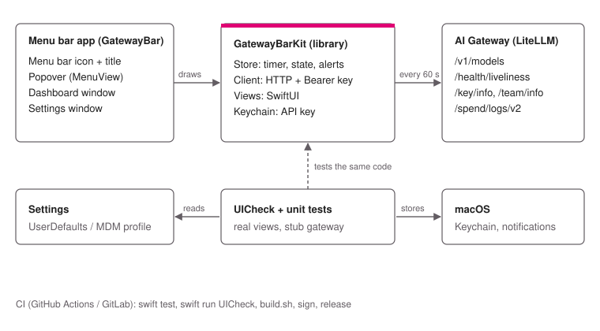

# Enexis AI Gateway (menu bar)

[](https://github.com/DennisvDijk/enexis-ai-gateway-bar/actions/workflows/ci.yml)

A macOS menu bar app that shows, at a glance, what you have spent on the Enexis AI Gateway, how much of your budget is left, and which models are available right now.



> **Status:** works against the built-in mock gateway and is covered by automated tests. It has **not yet been run against the real Enexis gateway**. The gateway is assumed to be LiteLLM; that is unconfirmed. See [What works, what is tested](#what-works-what-is-tested).

## What you get
- **Menu bar item:** Enexis mark with a status dot, plus your spend, your budget percentage or only the icon (your choice). Shows `offline` or `key?` when something is wrong.
- **Popover:** spend against budget with the period taken from the gateway (for example weekly $120), today / month / team tiles, and the model list with availability and per-model spend today.
- **Dashboard window:** open the app again (Spotlight or Finder) and the same view opens in a normal window. Useful when the menu bar is full or hidden by Ice or Bartender.
- **Notifications:** budget at your threshold (default 80%) and at 100%; models added, removed, going down and coming back.
- **Safe by design:** the API key lives in the macOS Keychain and is only ever sent to your gateway.
- **Managed deployment:** URL, interval, threshold and style can be preset with an MDM profile.

The app interface itself is currently in Dutch.

## Install and set up
1. Build it (below) or download the `.dmg` from a release, and put `GatewayBar.app` in `/Applications`.
2. First launch: right-click, Open (the app is ad-hoc signed until a Developer ID is set up).
3. Click the menu bar icon, then the gear. Enter the gateway URL and your own API key, then save.

Requires macOS 14 or later.

## Build and test
```sh
./build.sh                # builds GatewayBar.app
./build.sh install        # also copies it to /Applications
swift run UICheck         # all UI tests; works with only the Command Line Tools
swift test                # unit tests; needs Xcode (runs in CI)
python3 mock/server.py    # fake gateway on port 4000 for trying it out
```

## What works, what is tested
| Feature | Verified how |
|---|---|
| All states (healthy, warning, over budget, degraded, down, key rejected, not configured) | UI tests in CI |
| Weekly budget from the gateway, team-budget fallback, percentage | UI and unit tests |
| Buttons: refresh, settings, "N more", open settings | UI tests (accessibility actions) |
| Settings form, key saved to the Keychain, live refresh | UI tests and manual run against the mock |
| Menu bar title in all four styles, icon rendering | UI tests |
| Notifications (budget, model changes) | Code present, **not tested**; only sent from the real `.app` |
| Start at login | Code present, **not tested** |
| Real Enexis gateway | **Never run** |
| A real mouse click in the menu bar | Not automated |

Known limits: not notarized, no auto-update. "Unavailable" detection needs `background_health_checks` on the proxy. A normal key only shows its own budget; the month total needs admin rights and shows "–" without them.

## CI and releases
- **GitHub Actions:** `ci.yml` runs unit tests, UI tests, the build and a signature check on every push and PR. `release.yml` builds a dmg and zip when you push a tag like `v1.0.0`.
- **GitLab:** `.gitlab-ci.yml` runs the same steps. It needs a macOS runner (tag in `MACOS_RUNNER_TAG`). It has not been run yet.

## Documentation
- [How it works](docs/ARCHITECTURE.md): components, one refresh cycle, states.
- [How-tos](docs/HOWTO.md): use, develop, release, roll out, GitLab.
- [Deployment to Enexis](docs/DEPLOYMENT.md): signing, notarization, MDM.
- [Changelog](CHANGELOG.md)

## If the menu bar icon is not visible
A full menu bar, or a menu bar manager such as Ice or Bartender, can hide it. Open GatewayBar again from Spotlight or Finder: the dashboard opens in a normal window.
