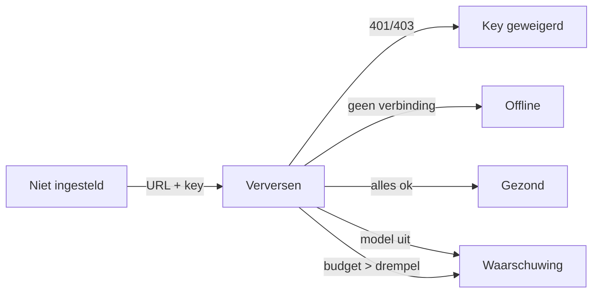

# Hoe het werkt

## Onderdelen
| Onderdeel | Doel |
|---|---|
| `Sources/GatewayBar` | Dunne app: menubalk-item, venster bij heropenen. Bevat bijna geen logica. |
| `Sources/GatewayBarKit` | Alle logica en views: `Store` (status, timer, meldingen), `Client` (HTTP), `Views`, `Keychain`. |
| `Sources/UICheck` | UI-tests zonder Xcode: laadt de echte views, leest de accessibility-tree, drukt op knoppen, nep-gateway. |
| `Tests/GatewayBarTests` | Unit tests (XCTest, draaien in CI). |
| `mock/server.py` | Nep-gateway voor handmatig proberen (poort 4000). |

## Eén verversing (elke 60 s, minimaal 15 s)
1. `/v1/models` voor de lijst, met `healthy_only` voor wat werkt. Verschil = niet beschikbaar.
2. `/health/liveliness` bepaalt of de gateway zelf bereikbaar is.
3. `/key/info` geeft uitgaven en budget van je key (wekelijks $120 komt hieruit); zonder budget valt de app terug op `/team/info`.
4. `/spend/logs/v2` geeft vandaag en per model. Maandtotaal vraagt admin-rechten, anders staat er "–".
5. `Store` zet dit om naar één `badge` (ok, waarschuwing, offline, key geweigerd) en een titel. De menubalk en het venster lezen alleen die status.
6. Budget over de drempel, of model erbij/weg/uit/terug: macOS-melding.

## Instellingen
- URL, interval, drempel, stijl: UserDefaults (domein `nl.gatewaybar.app`). Een MDM-profiel wint van de gebruiker.
- API-key: macOS Keychain, nooit in een bestand.

## Statussen

