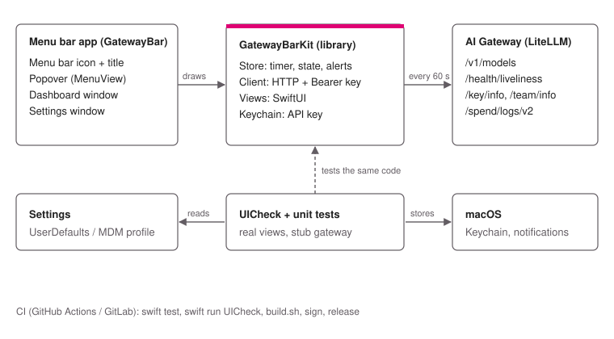
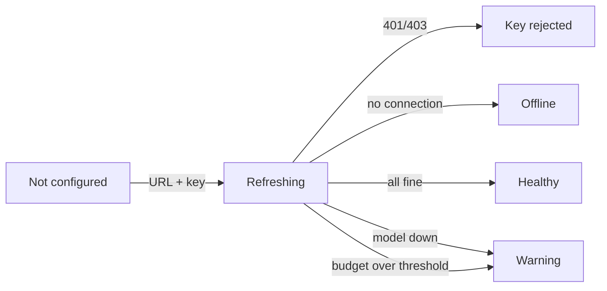

# How it works

## Components
| Part | Purpose |
|---|---|
| `Sources/GatewayBar` | Thin app: the menu bar item and the window on reopen. Almost no logic. |
| `Sources/GatewayBarKit` | All logic and views: `Store` (state, timer, notifications), `Client` (HTTP), `Views`, `Keychain`. |
| `Sources/UICheck` | UI tests without Xcode: loads the real views, reads the accessibility tree, presses buttons, uses a stub gateway. |
| `Tests/GatewayBarTests` | Unit tests (XCTest, run in CI). |
| `mock/server.py` | Fake gateway for manual testing (port 4000). |

## One refresh (every 60 s, minimum 15 s)
1. `/v1/models` lists the models; with `healthy_only` it lists the working ones. The difference is "unavailable".
2. `/health/liveliness` tells whether the gateway itself is reachable.
3. `/key/info` returns spend and budget for your key (the weekly $120 comes from here). Without a budget the app falls back to `/team/info`.
4. `/spend/logs/v2` gives today's spend and spend per model. The month total needs admin rights; otherwise it shows "–".
5. `Store` turns this into one `badge` (ok, warning, offline, key rejected) and a title. The menu bar and the window only read that state.
6. Budget over the threshold, or a model added, removed, down or back up, triggers a macOS notification.

## Settings
- URL, interval, threshold, style: UserDefaults (domain `nl.gatewaybar.app`). An MDM profile overrides the user's values.
- API key: macOS Keychain, never in a file.

## States

## Testing approach
Without Xcode there is no UI-test framework, so `UICheck` hosts the real SwiftUI views in an offscreen window, switches accessibility on, reads the accessibility tree and presses buttons with `accessibilityPerformPress`. A `URLProtocol` stub plays the gateway. The same checks run locally, on GitHub and on GitLab.

## What is tested and what is not
See the table in the [README](../README.md#what-works-what-is-tested).
